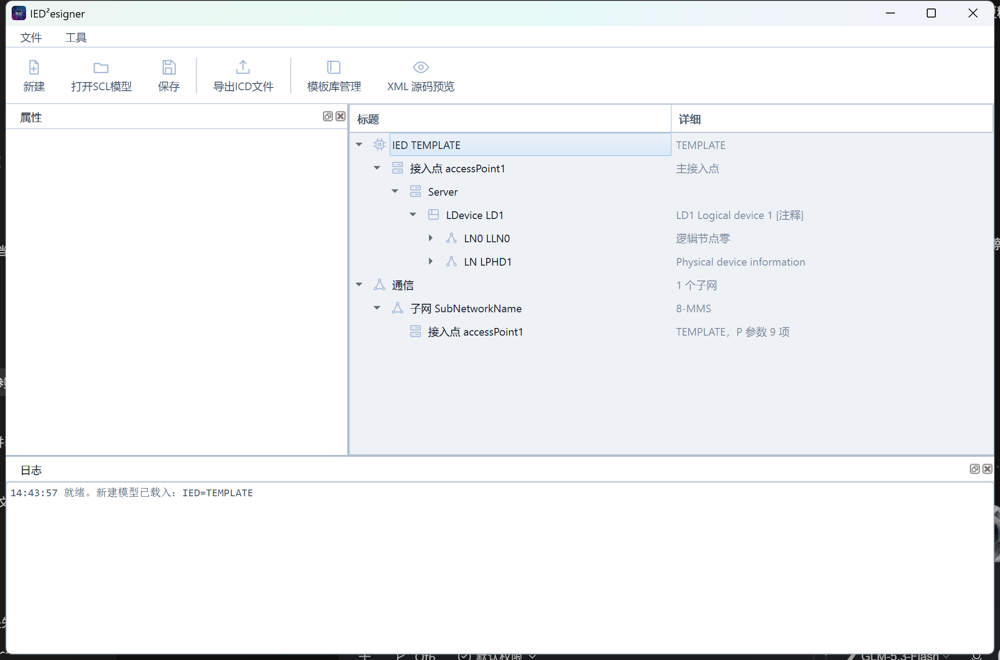
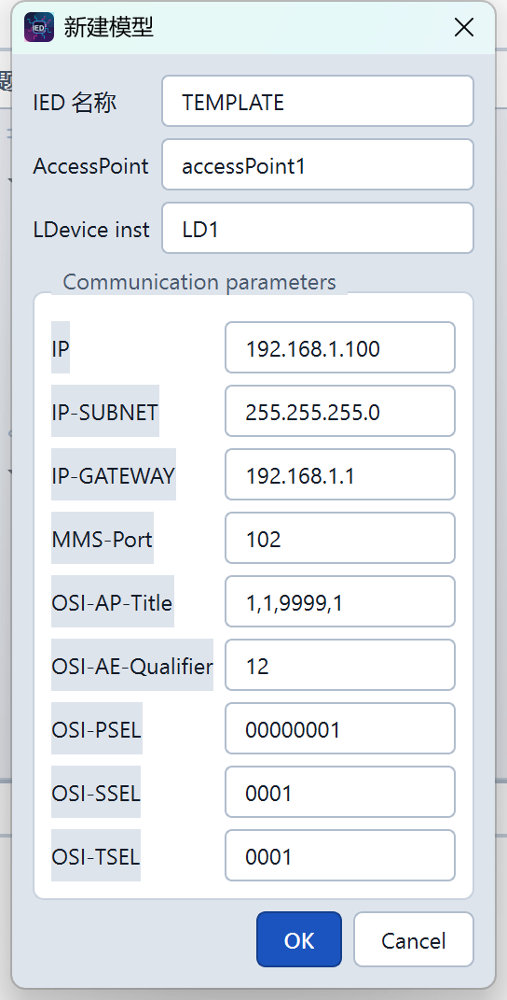
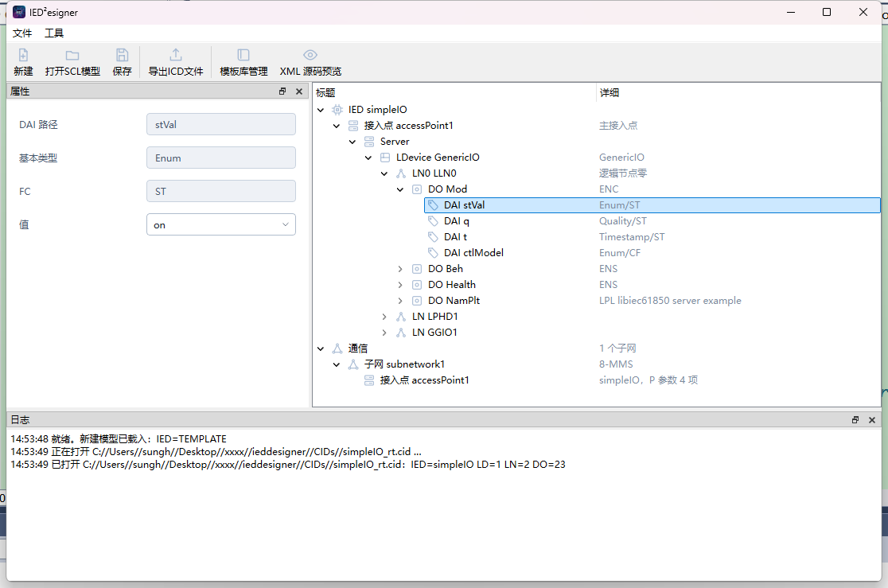
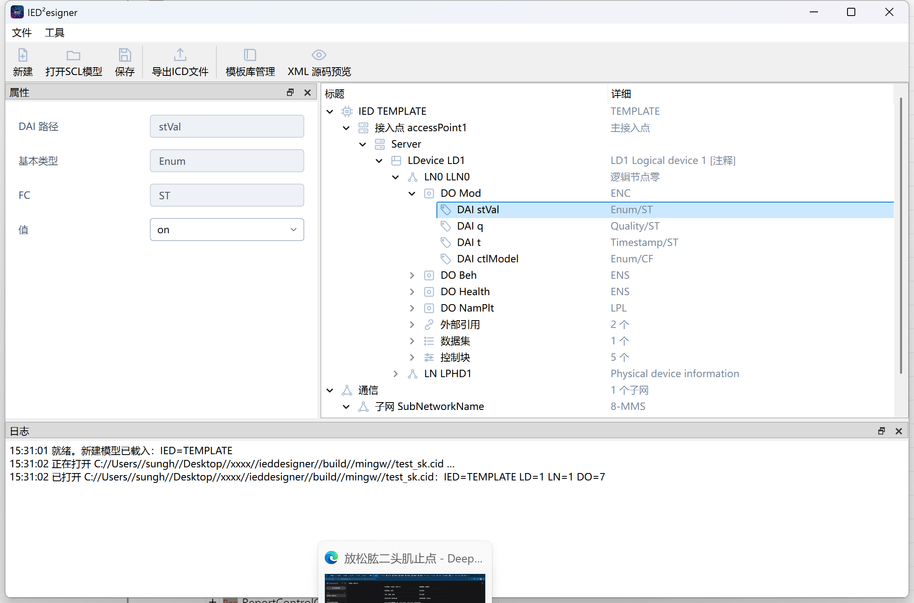
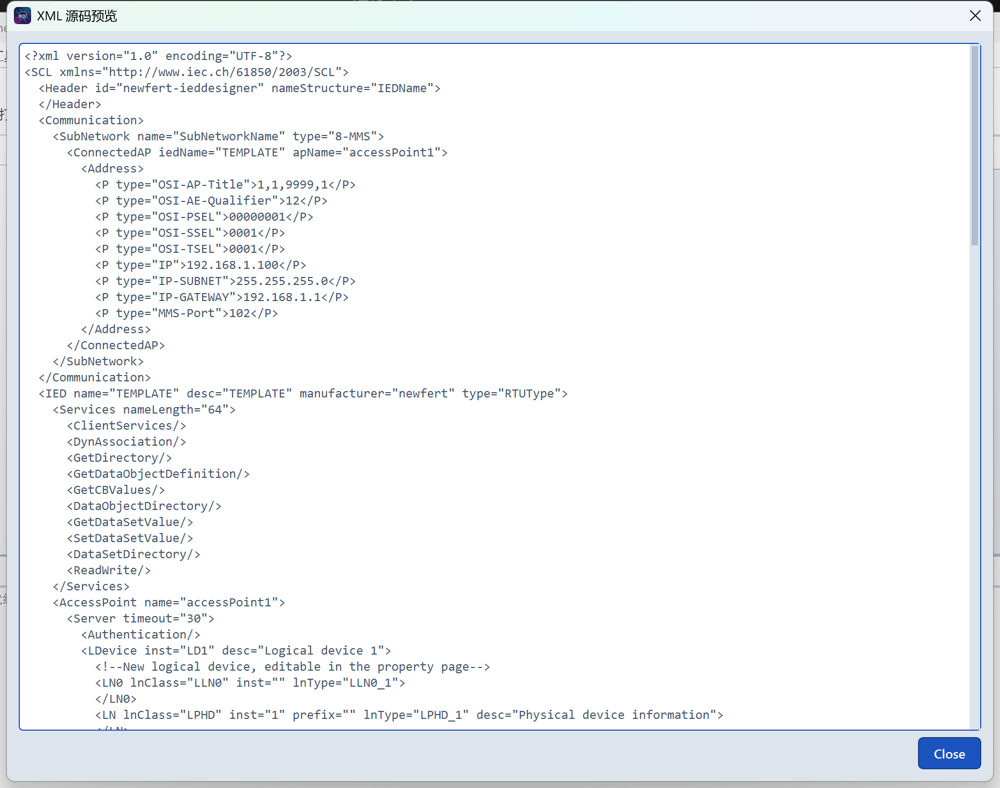

# IED²esigner 使用说明

> 面向第一次接触本工具的用户。不需要懂 SCL 文件内部的写法，跟着本说明一步步操作即可完成一个 IED 模型的新建、编辑和导出。
>
> 文档版本：2026-10-13（v2，增补外部引用 ExtRef、FCDA 编辑器改造、语言切换/布局记忆等第三期功能）· 配图基于当前版本界面

---

## 1. 这个程序是干什么的

**IED²esigner** 是一个 IEC 61850 模型配置工具。简单说：电力自动化设备（保护装置、测控装置、RTU 等）接入变电站监控系统时，需要一份描述"我有哪些数据、我监听哪些地址"的说明文件，这个格式叫 **SCL**（常见扩展名 `.icd` / `.cid` / `.scd`）。本程序就是用来**新建、查看、修改、导出**这类文件的。

| 你想做的事 | 本程序支持情况 |
|---|---|
| 从零新建一个 IED 模型 | ✅ 有模板，填几个参数即可 |
| 打开并修改已有的 ICD / CID 文件 | ✅ 完整支持，字段往返保真 |
| 打开 SCD（全站文件），提取其中一台装置修改后导出 CID | ✅ 支持（见下方重要提醒）|
| 把 SCD 编辑后**回写**成完整 SCD | ❌ 不支持，会丢失其他装置和站级描述 |
| 导出 CSV 点表（给监控/组态用） | ✅ |

> **⚠️ 重要提醒**：保存文件时，程序输出的是"当前加载的那一个 IED + 通信段 + 数据类型模板"。如果打开的是多装置的 SCD 文件，**另存会丢掉其他 IED 和变电站描述段（Substation）**。正确用法是：把 SCD 当作素材提取单个装置，另存为新的 CID，不要覆盖原 SCD 文件。

---

## 2. 启动与界面认识

双击 `ieddesigner.exe` 启动。程序启动后会自动载入一个空白的"新建模型"骨架，可以直接在上面改。



界面上一共 6 个区域，先混个脸熟：

| 区域 | 位置 | 作用 |
|---|---|---|
| **菜单栏** | 顶部（文件、工具） | 所有功能的入口 |
| **工具栏** | 菜单栏下方的大按钮 | 最常用的操作：新建 / 打开 / 保存 / 导出 ICD / 模板库 / XML 预览 |
| **属性面板** | 左侧停靠窗格 | 选中树里任何一个节点后，这里显示它的全部属性，可直接修改 |
| **模型树** | 中间大区域 | 整个 IED 模型的目录结构，两列：**标题**（节点名）、**详细**（补充信息）|
| **日志窗格** | 底部停靠窗格 | 每一步操作和结果都会记录在这里，出错时看这里 |
| **状态提示** | 各窗口标题上的小图标 | 停靠窗格可关闭/浮动，点叉关闭后可在"窗口"布局中恢复（拖拽边框可调大小）|

> 💡 界面上所有数值、IP 地址、路径都用**等宽字体**显示，这是有意为之——方便逐位核对工程参数。

### 2.1 界面语言与布局记忆

- **语言切换**：工具菜单 → **Language**，选 `中文 (Chinese)` 或 `English`，写入偏好后**重启程序生效**（当前窗口不变）。
- **布局记忆**：程序关闭时自动记住窗口大小位置、属性/日志窗格的位置和大小，下次启动原样恢复。想让布局乱了之后"重置"，删掉注册表 `HKEY_CURRENT_USER\Software\newfert\ieddesigner` 的 `winGeometry`/`winState` 两个值即可。

---

## 3. 基本操作：树、属性面板、日志

### 3.1 模型树

- **展开/折叠**：点击节点前的小三角，或双击节点。
- **查看/编辑属性**：**左键单击**选中节点，属性面板立即显示该节点的属性。
- **右键菜单**：在节点上点右键，会弹出针对该节点类型的操作菜单（添加/删除/复制粘贴/展开折叠等）。不同节点能做的事不同，例如：
  - 在 IED 上：添加修订历史、添加附加接入点、获取引用
  - 在 LDevice 上：添加/删除/复制/粘贴逻辑设备
  - 在 LN/LN0 上：添加数据集、添加外部引用、添加各类控制块、添加 DO
  - 在通信段：添加子网、接入点、GSE/SMV 通信地址
- **详细列**（第二列）显示节点的关键参数摘要，例如 LDevice 行会显示 `LD1 Logical device 1 [注释]`，接入点行会显示 `P 参数 9 项`。

### 3.2 属性面板

- 在属性面板里**直接点击输入框修改值**，改完点击其他地方（失去焦点）即生效，同时模型树自动刷新。
- 灰底/不可编辑的行表示该值**只读**（例如 LDName，它由 IED 名 + 实例号自动派生，程序不允许直接改）。
- 修改不合法时（比如名称里带了减号），会弹出"Validation failed"提示框说明原因，原值恢复。

### 3.3 日志

日志是排查问题 first place。每行格式：`时间 级别 内容`，级别含义：

| 级别 | 含义 |
|---|---|
| INFO | 常规操作记录（打开、新建、修改）|
| OK | 校验通过类的好消息 |
| WARN | 有问题但程序能继续（比如装置模型里有程序已知的小怪癖）|
| ERR | 失败，需要处理 |

特别说明一行常见的日志：

```
Loader check passed · DI=5 AI=8 DO=5 AO=8 SG=2
```

这是程序用内置的 IEC 61850 装载器对生成的文件做的"模拟读入"自检：DI/AI/DO/AO/SG 分别是点表中**遥信、遥测、可控 DO、模拟量输出、定值组**的引用数量。只要这行显示 passed / OK，说明生成的文件能被标准协议栈读起来。

日志同时会写入 exe 同目录的 `log\年-月-日.log` 文件，方便事后查。

---

## 4. 新建一个模型（手把手）

点工具栏第一个按钮 **新建**，弹出对话框：



### 4.1 基本信息组（3 项）

| 字段 | 默认值 | 是干什么的 | 怎么填 |
|---|---|---|---|
| **IED 名称** | TEMPLATE | 装置的全局唯一名字，写进 SCL 的 `<IED name="...">`，监控后台就是用它来识别这台装置的 | 换成你的装置名，如 `PLCU1`。**规则**：1~64 个字符、必须字母开头、只能含字母/数字/下划线 |
| **AccessPoint** | accessPoint1 | 接入点名。一台装置可以有多个接入点（物理网口/冗余口），这是主接入点 | 一般不改；有冗余接入需求时按图纸命名 |
| **LDevice inst** | LD1 | 第一个逻辑设备的实例号，模型树里的 `LD1` 就是它 | 一般不改；多逻辑设备时后续在树里右键添加 |

### 4.2 通信参数组（9 项）

这一组是装置的"网络名片"，决定了监控后台怎么连它：

| 字段 | 默认值 | 是干什么的 | 怎么填 |
|---|---|---|---|
| **IP** | 192.168.1.100 | 装置自己的 IP 地址 | 按现场分配填，必须是合法 IPv4（4 段 0~255，如 192.168.1.100）|
| **IP-SUBNET** | 255.255.255.0 | 子网掩码 | 一般 C 类网保持默认 |
| **IP-GATEWAY** | 192.168.1.1 | 默认网关 | 按现场填；跨网段通信时必填对 |
| **MMS-Port** | 102 | MMS 通信端口，**102 是 IEC 61850 MMS 的国际标准端口** | 除非现场规约特别要求，否则保持 102。范围 1~65535 |
| **OSI-AP-Title** | 1,1,9999,1 | OSI 应用进程标题（MMS 建立关联时的寻址参数之一）| **保持默认**，除非与对端监控系统的规约文件明确要求其他值 |
| **OSI-AE-Qualifier** | 12 | OSI 应用实体限定符 | 同上，保持默认 |
| **OSI-PSEL** | 00000001 | OSI 表示层选择符 | 同上 |
| **OSI-SSEL** | 0001 | OSI 会话层选择符 | 同上 |
| **OSI-TSEL** | 0001 | OSI 传输层选择符 | 同上 |

> 💡 OSI 五项是"配套的暗号"，两侧（装置和后台）必须一致才连得上。**没有明确依据时不要乱改**，改之前先问后台厂家要规约参数。

填完点 **OK**（或 Cancel 放弃）。校验不通过（IP 写错、名称非法等）会弹提示，改对为止。

### 4.3 新建之后有什么

新建的模型自带：一个逻辑设备 LD1（含 LN0 和 LPHD 两个逻辑节点）、完整的 9 项通信参数、标准的 Services 能力声明。接下来就是往里面"添肉"——加逻辑节点、数据点、数据集和控制块。

---

## 5. 打开已有文件

点 **打开SCL模型**，选择文件。支持 `.icd` `.cid` `.scd`（也可以选"所有文件"打开其他 SCL 家族文件）。

- **文件里有多个 IED 时**（SCD 常见），会弹出列表让你选择要编辑哪一个。
- 打开成功后，日志会显示统计：`IED=simpleIO LD=1 LN=2 DO=23`（装置名、逻辑设备数、逻辑节点数、数据对象数）。
- 再次提醒：编辑后另存只会包含你选中的这个 IED（见第 1 节提醒）。

---

## 6. 编辑模型：每个节点是什么、每一项怎么填

先把模型的"家族关系"讲清楚，后面所有编辑都围绕它。看一张加载了真实文件（libiec61850 的 simpleIO 示例）的截图：



树从上到下的层级：

```
IED（装置）
├─ 修订历史（可选，保存/导出时自动追加当天条目）
├─ 接入点 AccessPoint（主）
│   └─ Server（服务）
│       └─ LDevice（逻辑设备，如 LD1）
│           ├─ LN0（逻辑节点零，装置级公共信息）
│           │   ├─ DO/DAI（数据对象与数据属性值）
│           │   ├─ 外部引用 ExtRef（跨装置信号订阅，见 6.10）
│           │   ├─ DataSet（数据集）
│           │   └─ 各类控制块（报告/GOOSE/采样值/日志/定值）
│           └─ LN（逻辑节点，如 LPHD、GGIO、MMXU）
├─ 附加接入点（可选，冗余口）
└─ 通信 Communication
    └─ 子网 SubNetwork
        └─ 接入点 ConnectedAP（含 IP 等地址参数、GSE/SMV 地址）
```

**一句话理解**：IED 是装置 → LDevice 是装置里的功能分区 → LN 是最小功能单元（每一个都对应国际标准里定义好的"类"，如 GGIO 是通用 IO、MMXU 是测量）→ DO 是 LN 里的数据点 → DAI 是给数据点设的具体值。数据集是"要上送的数据打包清单"，控制块定义"怎么送"（报告/GOOSE/采样值）。

### 6.1 IED（根节点）的属性

选中 `IED xxx` 节点，属性面板共 9 行：

| 属性 | 说明 | 怎么填 |
|---|---|---|
| IED name | 装置名（同 4.1）| 标识规则同前 |
| Description | 装置描述 | 中文备注随意，如"1 号主变保护" |
| Manufacturer | 制造厂 | 如 `newfert` |
| Type | 装置型号 | 如 `RTUType` |
| AccessPoint | 主接入点名 | 同 4.1 |
| IP / Subnet mask / Gateway | 网络三件套 | 同 4.2。**在这里改会自动同步到下方通信段**，两处永远一致 |
| Port | MMS 端口 | 同 4.2，1~65535 |

### 6.2 Server（服务节点）

| 属性 | 说明 | 怎么填 |
|---|---|---|
| timeout | 服务端超时时间（秒）| 填非负整数；**留空 = 不在文件里输出该属性**（用默认值）|
| Authentication | 是否输出认证声明 | 填 `true` / `false`（或 1/0）|

### 6.3 修订历史（Hitem）

记录文件改了什么，纯备注性质，不影响通信。5 列：`version`（版本号）、`what`（改了什么）、`who`（谁改的）、`when`（何时）、`why`（为什么改）。右键 IED → 添加修订历史手动填写。

> 💡 **自动记录**：保存/导出 CID、ICD 时程序会自动追加（或更新当天已有的）一条"模型更新并保存"的 Hitem，同一天多次保存不会堆积重复条目。不需要手动维护也能留下修改痕迹。

### 6.4 接入点（AccessPoint）

| 属性 | 说明 |
|---|---|
| Name | 接入点名，标识规则同 IED 名 |
| ServerAt | 仅附加接入点用：填**主接入点的名字**表示"该口共用主口的服务"，留空表示独立接入点 |

### 6.5 LDevice（逻辑设备）

| 属性 | 说明 | 怎么填 |
|---|---|---|
| Instance | 实例号，如 LD1 | 标识规则同前；全文件唯一 |
| LDName | 完整逻辑设备名 | **只读**。SCL 规范里它就是 `IED名+实例号` 派生的，改 Instance 它自动跟着变 |
| Description | 描述 | 随意 |
| Comment | XML 注释 | 会以 `<!-- 注释 -->` 形式写进文件，给人看的，程序不解析 |

### 6.6 逻辑节点 LN0 / LN

| 属性 | 说明 | 怎么填 |
|---|---|---|
| Prefix | 前缀 | 区分同类 LN，可留空；填则须符合标识规则（如 `Q0`）|
| LnClass | 逻辑节点类名 | **只读**（LN0 固定 LLN0；新建 LN 时选定）|
| Inst | 实例号 | 纯数字（1、2、3…），LN0 固定为空；同一前缀+类名下不能重复 |
| Description | 描述 | 随意 |
| Comment | XML 注释 | 同 LDevice |

常用 LN 类：**GGIO** 通用输入输出（遥信遥测遥控都用它兜底）、**MMXU** 测量、**LPHD** 物理设备信息、**SGCB** 定值组控制。添加 LN 时从模板里选类名即可。

### 6.7 DO（数据对象）与 DAI（数据属性值）

- **DO** 是数据点。属性：`Name`（标识规则同前）、`CDC`（数据类型，只读）、`Description`（描述——它会被写进文件的 DOI/DAI "d" 值里，监控后台显示的点描述就是它）。
- **DAI** 是给 DO 里的属性设的初始值。选中 DAI 节点后属性面板 4 行：

| 属性 | 说明 |
|---|---|
| DAI 路径 | 如 `stVal` 或结构化的 `mag.f`，只读 |
| 基本类型 | Enum / BOOLEAN / FLOAT32 / INT32 / Timestamp 等，只读 |
| FC | 功能约束：ST 状态类、MX 测量类、CF 配置类、SP 定值类等，只读 |
| 值 | **可编辑**，按类型约束校验 |

**值怎么填（重点）**：

| 基本类型 | 填法 |
|---|---|
| Enum | 下拉框选择，只能选列出的合法值（如 Beh 的 on/blocked/test/off）|
| BOOLEAN | 下拉框选 true / false |
| FLOAT32 / FLOAT64 | 数字，可带小数点和负号（如 3.14、-220.5）|
| INT8~INT64 / UINT8~UINT64 | 整数 |
| Timestamp / 其他文本型 | 按提示的文本格式填 |
| **清空值** | 表示**删除**这条 DAI 设置（文件里不再输出它）|

填了不合法的值会弹出提示并保持原值。

### 6.8 DataSet（数据集）

数据集 = 一包要一起上送的数据点的引用清单。

| 属性 | 说明 |
|---|---|
| Name | 名字，标识规则同前（如 `dsRelay`）|
| Description | 描述 |
| FCDA 成员 | 每条引用含 8 项：iedName（数据来源装置名）、ldInst（逻辑设备）、prefix / lnClass / lnInst（定位到逻辑节点）、doName / daName（数据点，daName 留空表示到 DO 级）、fc（功能约束 ST/MX/CF 等）|

**FCDA 编辑器怎么用**（右键数据集 → "编辑 FCDA 成员"）：

- 左侧源模型树：**勾选 DO** 生成 DO 级 FCDA 成员；展开 DO 后**勾选某个 DAI**（如 `stVal`、`mag.f`）生成 **DA 级 FCDA**（daName 自动填路径，FC 取该 DAI 的精确功能约束，不再是按 CDC 猜测）。
- 勾选/取消都是**增量生效**：勾了马上加到右侧成员列表，取消马上移除，已有成员的顺序不会被重排。
- 右侧成员列表支持 **上移 / 下移 / 移除**——列表顺序就是保存后 CID 里 `<FCDA>` 的出现顺序。
- 点 OK 提交，点 Cancel 放弃全部改动。

### 6.9 五类控制块（挂在 LN0 或 LN 下）

控制块决定"数据集里的数据怎么送出去"。都在节点右键里添加，添加后选中可编辑全部字段：

**① 报告控制块 ReportControl（BRCB 缓存 / URCB 非缓存）**——事件上送：

| 字段 | 说明 | 怎么填 |
|---|---|---|
| name | 控制块名 | 标识规则同前 |
| rptID | 报告 ID | 留空=不输出；建议填唯一名，如 `TEMPLATE_LD1_brcb1` |
| datSet | 绑定的数据集 | 从已建数据集里选名字 |
| ConfRev | 配置版本号 | 数据集内容变了要递增，一般从 1 开始 |
| intgPd | 周期上送间隔（毫秒）| 留空=不周期上送；如 5000 表示每 5 秒 |
| bufTime | 事件打包缓冲时间（毫秒）| 留空=不输出 |
| buffered | true=BRCB（断网补送），false=URCB | 一般遥信用 true |
| indexed | 是否允许多客户端复用 | 一般 true |
| RptEnabled max | 最大客户端连接数 | 留空=不输出；一般 1~4 |
| TrgOps 触发条件 | dchg=值变化、qchg=品质变化、dupd=数据更新、period=周期、gi=总召 | 遥信一般勾 dchg+qchg；按点表要求 |
| OptFields 可选字段 | seqNum 序号、timeStamp 时标、dataSet 数据集名、reasonCode 原因码、dataRef 引用、bufOvfl 溢出、entryID 条目号、config 配置版本 | 按后台要求，一般至少带 seqNum 和 timeStamp |

**② GOOSE 控制块 GSEControl**——装置间快速跳合闸信号：

| 字段 | 说明 |
|---|---|
| name | 控制块名 |
| appID | 应用标识，全站唯一（配合通信段的 MAC/APPID 地址）|
| datSet | 绑定的数据集 |
| fixedOffs | true=固定偏移（采样同步场景），一般 false |
| ConfRev | 配置版本号 |

**③ 采样值控制块 SampledValueControl**——SV（如合并单元的电压电流量）：

| 字段 | 说明 | 怎么填 |
|---|---|---|
| name / smvID / datSet / ConfRev | 同上，smvID 全站唯一 | |
| smpRate | 每周期采样点数 | 常见 80（100 点另有规约），按 MU 规格填 |
| nofASDU | 每帧包含的 ASDU 数 | 一般 1 |
| smpMod | S=每周波采样 / P=每秒采样 | 一般 S |

**④ 日志控制块 LogControl**——本地日志存储：name / datSet / logName（日志名）/ intgPd（周期）/ TrgOps（触发条件，含义同报告控制块）。

**⑤ 定值控制块 SettingControl**——定值组：name / datSet / **numOfSG**（定值组数量，填正整数；不填=不输出该控制块）。

### 6.10 外部引用 ExtRef（跨装置信号订阅）

外部引用声明"我这个装置的输入来自别的装置的哪个数据点"——GOOSE 订阅方的接收声明，写在 LN0/LN 的 `<Inputs>` 段里。**典型场景**：本装置要订阅对侧保护装置 GOOSE 发来的跳闸信号，就得在这里登记一条引用。

**怎么添加**：右键 LN0 或 LN 节点 → **添加外部引用**（已添加的条目挂在"外部引用"分组下，右键可编辑/删除）：



编辑对话框左边是**当前模型的浏览树**——点击某个 DO（DO 级引用）或 DAI（DA 级引用，自动填 daName）即可自动填充右侧表单；右边 9 个字段也可以直接手填（**跨装置引用就是把 iedName 手动改成对侧装置名**，树里只能点到自己）：

| 字段 | 必填 | 说明 | 怎么填 |
|---|---|---|---|
| iedName | ✅ | **信号来源**装置名 | 本装置内引用保持当前 IED 名；订阅 GOOSE 填对侧装置名（与对侧 ICD 的 IED name 一致）|
| ldInst | | 来源逻辑设备实例 | 如 `LD2`；对侧装置的 LD 号查它的 ICD |
| prefix / lnClass / lnInst | lnClass 必填 | 来源逻辑节点定位 | 如 `GGIO` / `1`，前缀可空 |
| doName | ✅ | 来源数据对象名 | 如 `Ind1`、`OpCli` |
| daName | | 来源 DA 名 | 留空 = DO 级引用；DA 级填路径如 `stVal`、`general` |
| Description | | 备注 | 随意，如"1 号主变保护跳闸" |
| intAddr | | 本装置侧的内部输入地址 | 按自家装置的输入定义填，可空 |

保存后文件里长这样（与手写 SCL 格式一致）：

```xml
<LN0 lnClass="LLN0" inst="" lnType="LLN0_1">
  <Inputs>
    <ExtRef iedName="REMOTE1" ldInst="LD2" lnClass="GGIO" lnInst="1" doName="Ind1" daName="stVal" intAddr="IN/1" />
  </Inputs>
  ...
```

> ⚠️ 跨装置引用要和**对侧装置的 GOOSE 发送侧**配套：对侧得有对应的 GSEControl + 数据集 + 通信段 GSE 地址（MAC/APPID），两侧在系统配置（SCD）里完成关联后才能通信。本工具生成的是订阅侧声明，发送侧在对侧装置的 CID 里。

### 6.11 通信段（Communication）

描述"装置在网络里怎么被找到、GOOSE/SV 往哪些组播地址发"。

**子网 SubNetwork**：`name`（子网名随意，如 subnetwork1）、`type`（MMS 网填 `8-MMS`）。

**接入点 ConnectedAP**：`apName` / `iedName` 要与上方 IED/接入点对应；Address 下的 P 参数就是第 4.2 节那 9 项（IP、掩码、网关、MMS-Port、OSI 五项）。**在这页修改会自动同步回 IED 属性页**，反之亦然，不用自己两头改。

**GSE 地址**（GOOSE 的组播地址，右键接入点添加）：

| 参数 | 说明 | 怎么填 |
|---|---|---|
| ldInst / cbName | 对应哪个逻辑设备的哪个 GOOSE 控制块 | 与 GSEControl 的所在 LD 和 name 一致 |
| MAC-Address | 组播 MAC | **必须在 01-0C-CD-01-00-00 起的 GOOSE 段内**，全站不重复（如 01-0C-CD-01-00-01、…-00-02 顺延）|
| APPID | 应用标识 | 十六进制，GOOSE 从 0x0001 起顺延，全站不重复 |
| VLAN-ID | VLAN 编号 | 十六进制，按现场交换机划分（默认 0x001）|
| VLAN-PRIORITY | 优先级 | GOOSE 一般 4~6 |
| MinTime / MaxTime | 重发间隔（毫秒）| GSE 专用，默认 10 / 1000 |

**SMV 地址**（SV 的组播地址）：同上，但 MAC 在 **01-0C-CD-04-xx** 段、APPID 从 **0x4000** 起顺延。

> ⚠️ GOOSE/SV 的 MAC 和 APPID 是"全站唯一"的资源，两台装置撞了地址会导致通信混乱。改之前先拿全站地址分配表核对。

---

## 7. 模板库

工具栏 **模板库管理** 打开，两个标签页：

- **公共数据类（CDC）模板**：列出内置的全部 CDC（SPS 单点、DPS 双点、INS 整数状态、MV 测量值、SPC 单点控制等）以及每个 CDC 包含的 DA 属性列表。支持按名字筛选；可以**添加/编辑/删除自定义 CDC 模板**（自定义的标为 Custom），用于现场特殊的数据结构。
- **逻辑节点（LNClass）模板**（只读）：标准 LN 类清单和各自包含的 DO，添加 LN 时就是从这里选。

## 8. XML 源码预览

工具栏 **XML 源码预览** 随时打开，实时显示当前模型将要生成的 SCL 文本（只读）：



用途：① 保存前确认生成结果；② 排查"我改的东西在文件里长什么样"；③ 拷贝片段给厂家核对。

## 9. 在线读取（从运行中的装置读模型）

工具菜单两个功能，配合调试用：

- **读取 IED 在线**：弹出对话框填装置 IP、端口（默认 102）、IED 名（可选），程序通过 MMS 协议**连上正在运行的装置**，把它内部的模型读回来变成可编辑模型。适合"手头没有 SCL 文件，装置却在线"的场景。
- **导入在线 JSON**：导入之前用在线浏览工具导出的 JSON 模型文件。

读取成功后同样会替换当前模型并统计 LD/LN/DO 数量，记得**另存**落盘。

## 10. 保存与导出

| 菜单项 | 产物 | 区别 |
|---|---|---|
| 文件 → 保存 | `.cid` | 存到当前文件；首次保存会弹路径框 |
| 文件 → 另存为 | `.cid` | 存到新路径 |
| 工具 → 导出 ICD 文件 | `.icd` | **不带通信段**（纯装置能力描述，供系统集成方引用）|
| 工具 → 导出 CID 文件 | `.cid` | **带完整通信段**（现场运行文件）|
| 工具 → 导出 CSV 点表 | `.csv` | 给监控组态用的点表（含 DI/AI/DO/AO/SG 引用）|

> 💡 **ICD 与 CID 的区别一句话**：ICD 是"我是谁、我有什么"（厂家提供），CID 是"我在这个站里怎么连、怎么送"（集成后下装的）。本程序两者都能生成，区别只在于是否包含通信段。

保存完成后看一眼日志里的 Loader check 是否通过，通过即说明文件能被标准协议栈解析。

### 10.1 XSD 校验（结构合规检查）

保存/导出 CID、ICD 时，程序会自动用 **IEC 61850-6 官方 schema（SCL 2003）** 对生成文件做结构合规校验：

- **通过**：日志显示 `XSD validation passed`；
- **有违规**：自动弹出错误列表窗口（**行号** + 错误信息），行号对应生成的文件，方便对照 XML 预览定位；
- **XML 预览窗口**里有"XSD validation"按钮，可随时手动触发（结果以弹窗/日志呈现）。

> 💡 XSD 校验管的是"结构合法"（必填属性、枚举值域、元素顺序），**引用正确性**（数据集/控制块/通信地址是否对得上）请配合 6.8~6.11 节的说明人工核对。校验基于 Edition 1（2003 命名空间）schema，TrgOps 的 gi、OptFields 的 bufOvfl/config、SMV 的 smpMod 等 Edition 2 特性暂不支持。

## 11. 命名与取值规则速查

| 项目 | 规则 |
|---|---|
| 各类名称（IED/LD/LN/DO/数据集/控制块/接入点）| 1~64 字符，**字母开头**，只能含字母、数字、下划线；同层不重名 |
| LN 实例号 Inst | 纯数字；LN0 固定为空 |
| IPv4 地址 | 4 段 0~255 的十进制数，点分隔 |
| MMS 端口 | 1~65535 整数，标准值 102 |
| 布尔输入 | `true` / `false`（也接受 1/0）|
| GOOSE MAC | `01-0C-CD-01-xx-xx` 段内，全站唯一 |
| SV MAC | `01-0C-CD-04-xx-xx` 段内，全站唯一 |
| GOOSE APPID / SV APPID | 十六进制；GOOSE 从 0x0001、SV 从 0x4000 起顺延，全站唯一 |

## 12. 常见问题（FAQ）

**Q1：打开文件报 "access point not found / no logical device"？**
文件里没有程序能识别的 IED 结构。SSD（只有站级描述、没有装置）就是这种情况，本工具不支持。确认打开的是 ICD/CID/SCD。

**Q2：保存后文件比原来小了很多、少了东西？**
正常现象，见第 1 节：程序只输出它加载的那一个 IED 和它认识的段落。**多 IED 的 SCD 千万不要覆盖保存。**

**Q3：我改了描述，文件里搜不到？**
请确认已经**保存**，并且是改完之后保存的。早期版本 LN/LDevice/DataSet 的描述确实不落盘，现已修复——用当前版本重改一遍即可。

**Q4：DAI 的值一直校验失败？**
对照第 6.7 节的类型表：Enum 只能下拉选、BOOLEAN 只能 true/false、数值型不能带字母。看弹窗提示里的类型名。

**Q5：两台装置连不通？**
按顺序核对：IP/掩码/网关是否正确 → 两端 MMS 端口是否一致（102）→ OSI 五项是否与后台一致 → 用 XML 预览确认导出的文件里确实是你改的值。

**Q6：GOOSE 收不到？**
核对三处一致性：GSEControl 的 name 与通信段 GSE 地址的 cbName 一致；所在 LDevice 与 ldInst 一致；MAC/APPID 与全站分配表不冲突。

**Q7：日志文件在哪？误操作能找回吗？**
exe 同目录 `log\年-月-日.log`。程序没有撤销功能，重大修改前建议先"另存为"备份一份。

**Q8：订阅别的装置的 GOOSE 信号，ExtRef 怎么填？**
见 6.10 节。三步：① 对侧装置的 ICD 里找到要订的点（IED 名/LD/LN/DO/DA）；② 本装置 LN0 右键添加外部引用，字段照抄对侧路径（iedName 填对侧装置名）；③ 组态关联与 GOOSE 地址（MAC/APPID）在系统配置阶段完成。订阅能不能通，还取决于对侧是否真的在发（GSEControl + 通信地址齐全）。

---

## 13. 附：最小 SCL 长什么样（帮助理解）

```xml
<SCL xmlns="http://www.iec.ch/61850/2003/SCL">
  <Header id="..." nameStructure="IEDName"/>
  <Communication>                        <!-- 6.11 通信段 -->
    <SubNetwork name="subnetwork1" type="8-MMS">
      <ConnectedAP iedName="TEMPLATE" apName="accessPoint1">
        <Address><P type="IP">192.168.1.100</P>...</Address>
      </ConnectedAP>
    </SubNetwork>
  </Communication>
  <IED name="TEMPLATE" desc="...">       <!-- 6.1 装置 -->
    <AccessPoint name="accessPoint1">
      <Server>                            <!-- 6.2 服务 -->
        <LDevice inst="LD1">              <!-- 6.5 逻辑设备 -->
          <LN0 lnClass="LLN0" inst="" lnType="LLN0_1">
            <DataSet name="dsRelay">...</DataSet>          <!-- 6.8 -->
            <ReportControl name="brcb1" .../>               <!-- 6.9 -->
          </LN0>
          <LN lnClass="LPHD" inst="1" lnType="LPHD_1"/>
        </LDevice>
      </Server>
    </AccessPoint>
  </IED>
  <DataTypeTemplates>...</DataTypeTemplates>  <!-- 数据类型字典，程序自动维护 -->
</SCL>
```

## 14. 术语速查表

| 缩写 | 全称 | 大白话 |
|---|---|---|
| IED | Intelligent Electronic Device | 智能电子设备，即保护/测控等装置 |
| SCL | Substation Configuration Language | 变电站配置语言，本程序读写的文件格式 |
| LD | Logical Device | 逻辑设备，装置内的功能分区 |
| LN | Logical Node | 逻辑节点，最小功能单元（GGIO=通用、MMXU=测量、LPHD=物理信息）|
| DO / DA | Data Object / Data Attribute | 数据对象 / 数据属性 |
| DAI | Data Attribute Instance | 给数据属性设的初始值 |
| CDC | Common Data Class | 公共数据类，规定一个点长什么样（SPS 单点、MV 模拟量…）|
| FC | Functional Constraint | 功能约束：ST 状态、MX 测量、CF 配置、SP 定值 |
| DataSet | 数据集 | 要上送的数据点打包清单 |
| ExtRef | External Reference | 外部引用：声明"我的输入来自别的装置的哪个点"，GOOSE 订阅方声明（见 6.10）|
| BRCB / URCB | 缓存/非缓存报告控制块 | 事件上送的"订阅规则" |
| GOOSE | Generic Object Oriented Substation Event | 装置间快速组播信号 |
| SV | Sampled Values | 采样值（合并单元的电压电流量）|
| MMS | Manufacturing Message Specification | IEC 61850 的通信协议，标准端口 102 |
| ConfRev | Configuration Revision | 配置版本号，数据集变了要加 1 |

---

*使用说明完 · 有疑问先看日志，再看 FAQ，最后找程序维护者*
